# SevoShop — Frontend (Next.js)

Frontend toko online **SevoShop**, dibangun dengan **Next.js 16 (App Router)**, **React 19**,
**TypeScript**, dan **Tailwind CSS v4**. Terhubung ke backend **Flask API** (SevoShop) dan
menyediakan alur lengkap: menjelajah produk, autentikasi, keranjang, checkout, pesanan, serta
dashboard admin untuk mengelola produk, kategori, dan pesanan.

- **URL Produksi (Vercel):** https://sevoshop.vercel.app
- **Backend API (Flask, Render):** https://sevoshop.onrender.com

> Kode aplikasi berada di subfolder **`sevoshop-app/`**. Jalankan semua perintah di bawah
> dari dalam folder tersebut (lihat langkah `cd sevoshop-app`).

---

## Overview

SevoShop adalah aplikasi e-commerce sisi frontend. Pengunjung dapat menjelajah katalog produk,
mendaftar/masuk, menambahkan barang ke keranjang, melakukan checkout, dan melihat riwayat pesanan.
Admin memiliki dashboard untuk operasi CRUD produk dan kategori serta memantau seluruh pesanan.
Sesi pengguna dan keranjang bertahan setelah refresh melalui localStorage.

Pengembangan bertahap:
- **Checkpoint 2** — fondasi React/Next.js (routing, komponen, fetch data, rendering).
- **Checkpoint 3** — autentikasi, route protection, keranjang, checkout, pesanan, dashboard CRUD,
  notifikasi toast, pengujian E2E Playwright, dan deployment ke Vercel.

---

## Fitur

### Pengunjung dan Customer
- Home menampilkan produk unggulan (Server Component, strategi cached).
- Daftar produk dengan pencarian live dan filter kategori (Client Component).
- Detail produk dengan judul halaman dinamis (generateMetadata).
- Daftar kategori dan pesanan.
- Registrasi (/register) dan login (/login) dengan validasi form.
- Keranjang (/cart): ubah/hapus item, subtotal, total, empty state.
- Checkout (/checkout): ringkasan pesanan dan buat pesanan (POST /orders).
- Pesanan customer (/orders, /orders/[id]): hanya pesanan milik pengguna.

### Admin (Dashboard)
- Manajemen produk (/dashboard): tabel + create/edit/delete (modal + konfirmasi inline).
- Manajemen kategori (/dashboard/categories): pola CRUD yang sama.
- Manajemen pesanan (/dashboard/orders): tampilan read-only seluruh pesanan.

### Lintas fitur
- AuthContext dan CartContext dengan pemulihan dan persistensi localStorage.
- Route protection: ProtectedRoute, AdminRoute, PublicOnlyRoute (menunggu sesi dipulihkan
  sebelum memutuskan redirect, sehingga refresh tidak melempar pengguna keluar).
- Notifikasi toast (react-hot-toast) pada seluruh operasi POST/PUT/DELETE dan keranjang.
- Error handling berlapis: res.ok di lib/api.ts, plus loading.tsx dan error.tsx per route.

---

## Teknologi

| Area | Teknologi |
|------|-----------|
| Framework | Next.js 16 (App Router, Cache Components), React 19 |
| Bahasa | TypeScript |
| Styling | Tailwind CSS v4 |
| Notifikasi | react-hot-toast |
| Sesi dan keranjang | localStorage (via React Context) |
| Konfigurasi API | NEXT_PUBLIC_API_BASE_URL (per lingkungan) |
| Pengujian E2E | Playwright |
| Deployment | Vercel |
| Backend | Flask API (SevoShop) di Render |

---

## Strategi Rendering

Tiga strategi diterapkan secara sadar (Next.js 16 cacheComponents):

| Halaman | Strategi | Keterangan |
|---------|----------|------------|
| /categories | Cached (cacheLife 'hours') | Kategori jarang berubah; mirip ISR. |
| /products | Cached (cacheLife 'minutes') | Berubah lebih sering; revalidasi pendek. |
| /products/[id] | Dynamic (SSR per-request) | Stok/harga selalu terkini. |

---

## Konfigurasi Environment

Salin `.env.example` ke `.env.local` (di dalam `sevoshop-app/`), lalu isi URL API:

```
NEXT_PUBLIC_API_BASE_URL=https://sevoshop.onrender.com
```

Di Vercel, variabel ini di-set lewat dashboard (Environment Variables).

---

## Menjalankan Secara Lokal

```
cd sevoshop-app
npm install
npm run dev        # http://localhost:3000
```

Perintah lain (dari dalam `sevoshop-app/`):

```
npm run build      # build produksi (tsc + next build)
npm run start      # jalankan hasil build
npx tsc --noEmit   # cek tipe tanpa output
```

---

## Menjalankan Test (Playwright)

```
cd sevoshop-app
npx playwright install

# Jalankan seluruh suite (otomatis menjalankan server lokal)
npm run test:e2e

# Terhadap URL produksi (PowerShell)
$env:PLAYWRIGHT_BASE_URL='https://sevoshop.vercel.app'; npm run test:e2e

# Terhadap URL produksi (bash)
PLAYWRIGHT_BASE_URL=https://sevoshop.vercel.app npm run test:e2e
```

Cakupan test:
- Navigasi home ke products (memakai getByTestId).
- Validasi form registrasi.
- Alur registrasi dan login (mock page.route()).
- global-setup.ts menyiapkan sesi buyer dan admin (storageState).
- Browsing journey buyer: keranjang, checkout, pesanan.
- Dashboard CRUD journey admin: create, edit, delete.

---

## Struktur Proyek

```
module-3-sevrianh/
\- sevoshop-app/            # Aplikasi Next.js
   |- app/                  # Route App Router (page/layout/loading/error)
   |  |- layout.tsx         # Root layout: Providers + Header + Footer + Toaster
   |  |- page.tsx           # Home (Server Component)
   |  |- products/          # List, detail [id], loading, error, nested layout
   |  |- categories/        # List kategori
   |  |- orders/            # Pesanan customer + detail [id]
   |  |- cart/ checkout/    # Keranjang dan checkout (Protected)
   |  |- login/ register/   # Form auth (PublicOnly)
   |  \- dashboard/         # Admin: produk, categories, orders (AdminRoute)
   |- components/           # Komponen UI dan form
   |- context/              # AuthContext, CartContext
   |- hooks/                # useAuth, useCart
   |- lib/                  # types.ts, api.ts, ui.ts, toast.ts
   |- tests/                # Playwright (spec + global-setup)
   |- docs/screenshots/     # Screenshot halaman utama
   \- playwright.config.ts
```

---

## Screenshot

Satu tampilan untuk tiap route aplikasi (gambar di `sevoshop-app/docs/screenshots/`).
Tabel di bawah memetakan setiap route ke file screenshot-nya. Tanda _(belum)_
berarti file gambar perlu ditambahkan.

| Route | Halaman | File |
|-------|---------|------|
| `/` | Home | `home.png` |
| `/products` | Daftar Produk | `products.png` |
| `/products/[id]` | Detail Produk | `product-detail.png` |
| `/categories` | Daftar Kategori | `categories.png` |
| `/register` | Registrasi | `register.png` |
| `/login` | Login | `login.png` |
| `/cart` | Keranjang | `cart.png` _(belum)_ |
| `/checkout` | Checkout | `checkout.png` _(belum)_ |
| `/orders` | Daftar Pesanan | `orders.png` _(belum)_ |
| `/orders/[id]` | Detail Pesanan | `order-detail.png` _(belum)_ |
| `/dashboard` | Dashboard Admin – Produk | `dashboard.png` |
| `/dashboard/categories` | Dashboard Admin – Kategori | `dashboard-categories.png` _(belum)_ |
| `/dashboard/orders` | Dashboard Admin – Pesanan | `dashboard-orders.png` _(belum)_ |

### Publik

#### Home — `/`
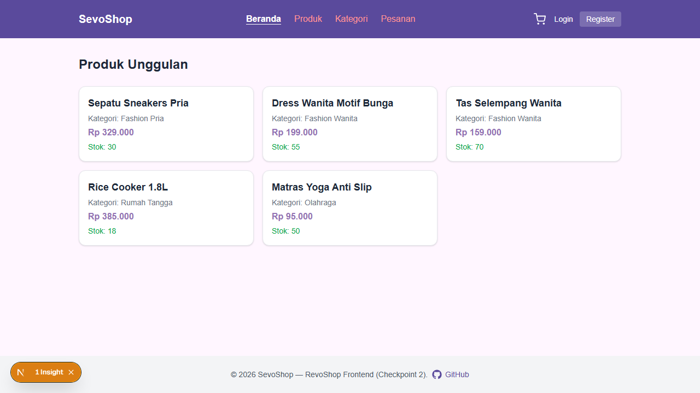

#### Daftar Produk — `/products`
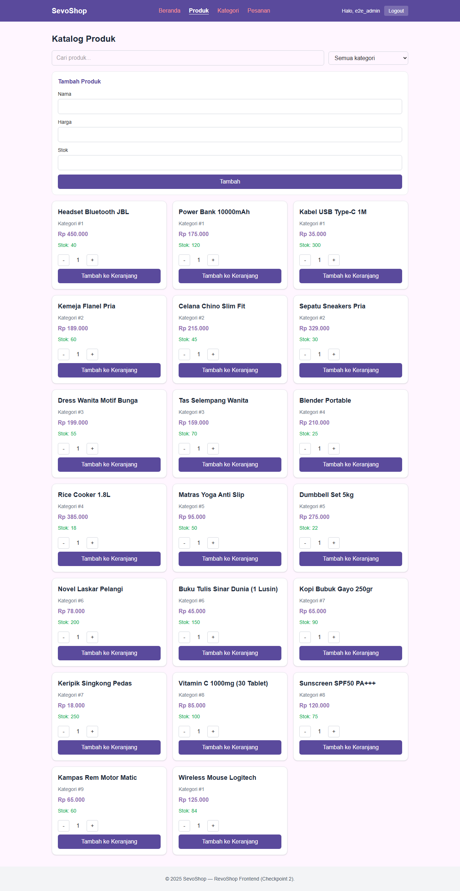

#### Detail Produk — `/products/[id]`
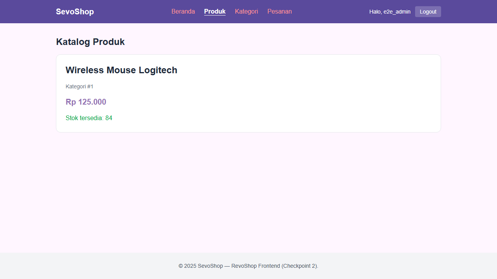

#### Daftar Kategori — `/categories`
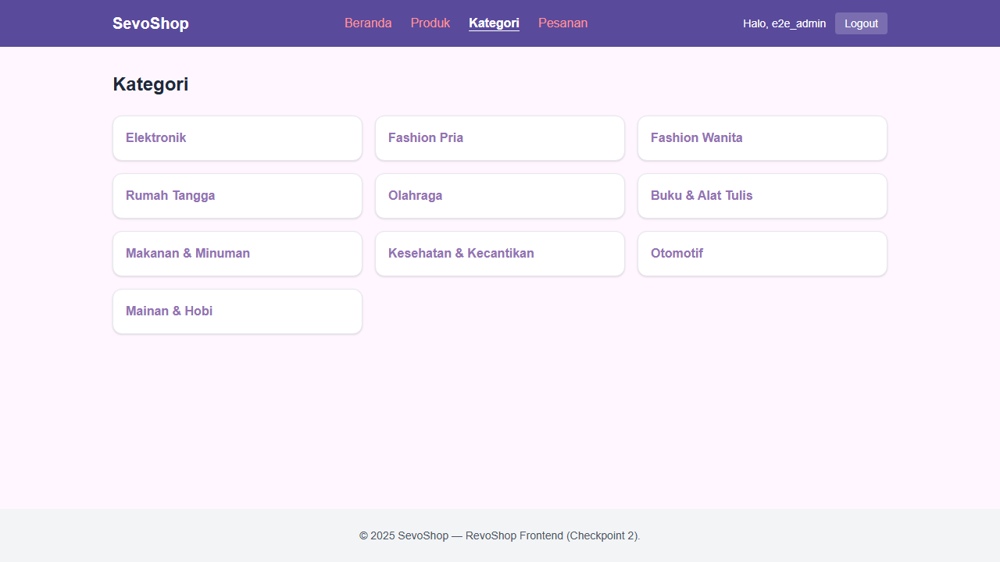

#### Registrasi — `/register`
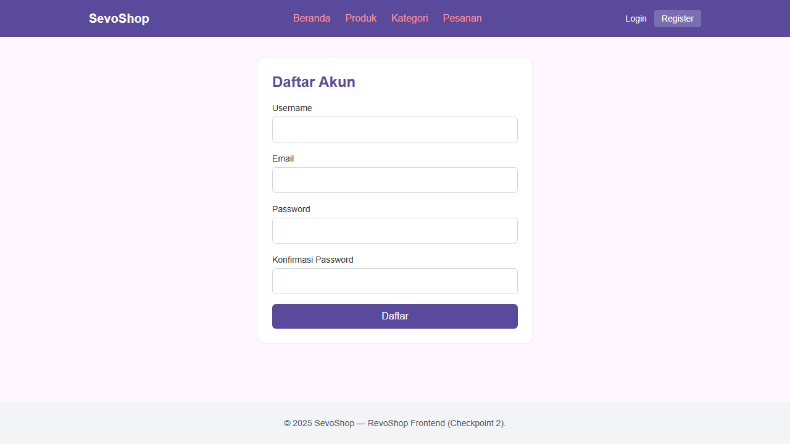

#### Login — `/login`
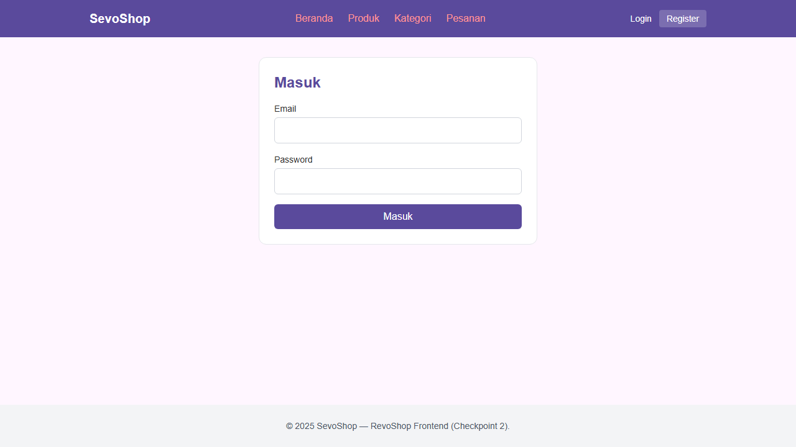

### Butuh Login (Buyer)

#### Keranjang — `/cart`
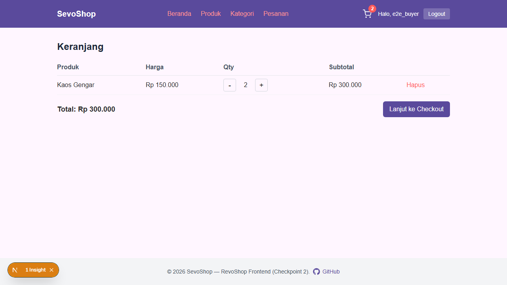

#### Checkout — `/checkout`
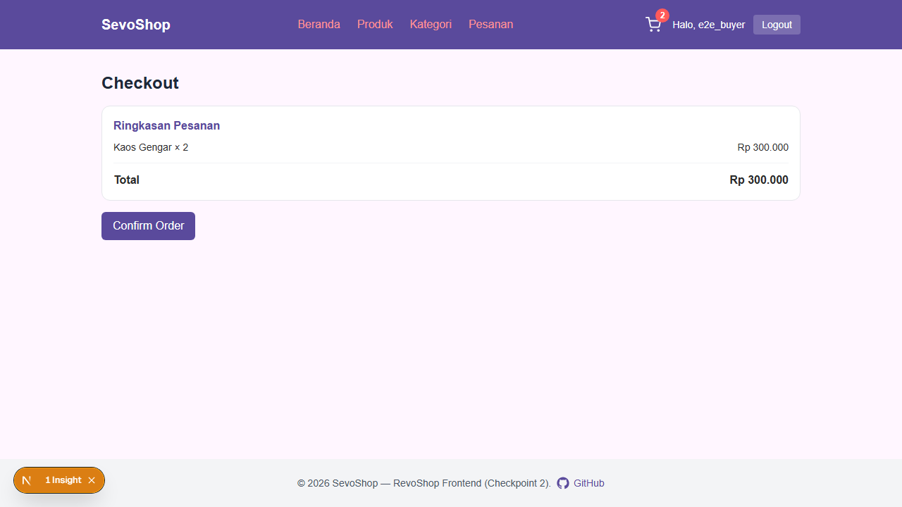

#### Daftar Pesanan — `/orders`
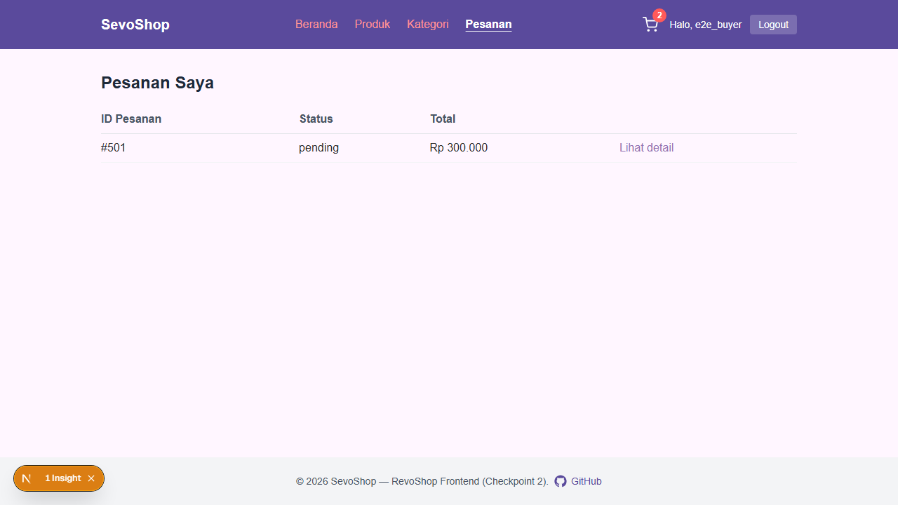

#### Detail Pesanan — `/orders/[id]`
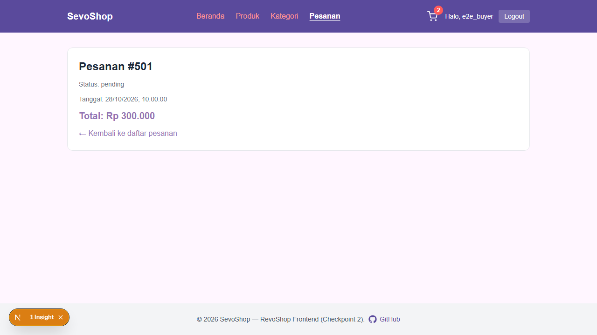

### Admin

#### Dashboard Admin – Produk — `/dashboard`
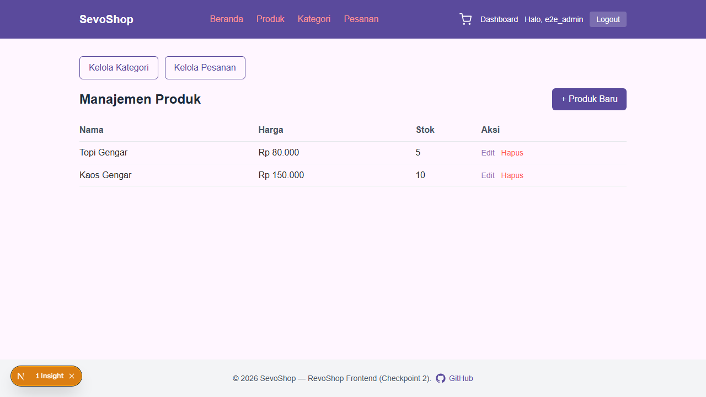

#### Dashboard Admin – Kategori — `/dashboard/categories`
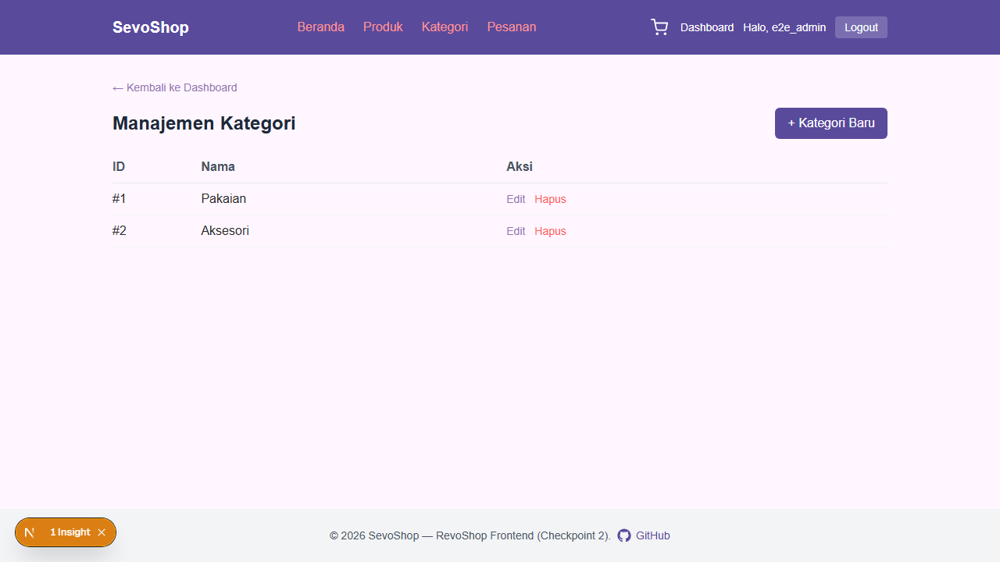

#### Dashboard Admin – Pesanan — `/dashboard/orders`
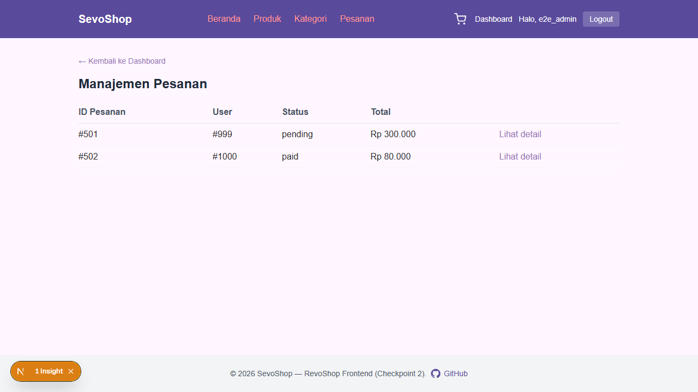

### Cart

